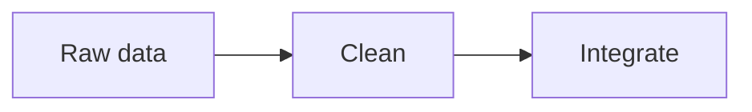

# Markdown Cheat Sheet

My personal Markdown reference for this semester. Every entry shows what a feature does, the Markdown source, and the rendered result. The label says where it works:

- **CommonMark** – works in the [CommonMark dingus](https://spec.commonmark.org/dingus/) and on GitHub
- **GitHub** – works on GitHub only

## Contents

- [Text](#text)
- [Lists](#lists)
- [Links and images](#links-and-images)
- [Code](#code)
- [Quotes](#quotes)
- [Tables](#tables)
- [Layout](#layout)
- [GitHub extras](#github-extras)
- [Pitfalls](#pitfalls)

---

## Text

### Headings

**CommonMark** · A `#` at the start of a line makes a heading; more `#` (up to six) make it smaller.

```markdown
#### A level-4 heading
```

#### A level-4 heading

### Paragraphs and line breaks

**CommonMark** · An empty line starts a new paragraph. A backslash (or two spaces) at the end of a line makes a line break inside a paragraph. Without it, a `.md` file joins the lines; in issues, pull requests and comments GitHub keeps every line break.

```markdown
First line\
second line in the same paragraph.

A new paragraph.
```

First line\
second line in the same paragraph.

A new paragraph.

### Italic, bold and both

**CommonMark** · One star for italic, two for bold, three for both.

```markdown
*italic*, **bold**, ***bold and italic***
```

*italic*, **bold**, ***bold and italic***

### Strikethrough

**GitHub** · Two tildes on each side cross the text out.

```markdown
~~no longer valid~~
```

~~no longer valid~~

### Inline code

**CommonMark** · Backticks mark code inside a sentence.

```markdown
Run `git status` to see your changes.
```

Run `git status` to see your changes.

### Escaping a character

**CommonMark** · A backslash shows a special character as it is instead of formatting.

```markdown
\*not italic\*
```

\*not italic\*

---

## Lists

### Unordered, ordered and nested lists

**CommonMark** · `-` makes bullet points, numbers make a numbered list, indenting nests a list.

```markdown
1. Fruit
   - Apple
   - Pear
2. Vegetables
   - Carrot
```

1. Fruit
   - Apple
   - Pear
2. Vegetables
   - Carrot

### Task lists

**GitHub** · `[ ]` and `[x]` in a list make checkboxes.

```markdown
- [x] Create repository
- [ ] Write cheat sheet
```

- [x] Create repository
- [ ] Write cheat sheet

---

## Links and images

### Inline and reference-style links

**CommonMark** · An inline link has the URL right after the text; a reference link defines the URL somewhere else in the file.

```markdown
[Course repository](https://github.com/breuert/data-integration)
and the [CommonMark spec][spec].

[spec]: https://spec.commonmark.org/
```

[Course repository](https://github.com/breuert/data-integration)
and the [CommonMark spec][spec].

[spec]: https://spec.commonmark.org/

### Relative link to another file

**CommonMark** · A path instead of a URL links to a file in the same repository; `../` goes up one folder.

```markdown
See the [licence](../../LICENSE) of this repository.
```

See the [licence](../../LICENSE) of this repository.

### Link to a section

**GitHub** · `#` plus the heading in lowercase, with spaces as `-`, jumps to that heading. GitHub creates these anchors automatically; the dingus does not.

```markdown
Back to the [contents](#contents).
```

Back to the [contents](#contents).

### Image with alt text

**CommonMark** · Like a link with `!` in front; the text in brackets is shown if the image cannot load and is read out by screen readers.

```markdown

```


### Image that is a link

**CommonMark** · Put the image inside the brackets of a link.

```markdown
[](https://github.com)
```

[](https://github.com)

---

## Code

### Fenced code blocks with syntax highlighting

**GitHub** · Three backticks start and end a code block (CommonMark). The language name after the backticks adds colours, which only GitHub shows.

````markdown
```python
print("Hello")
```

```bash
git add .
```

```json
{"name": "Idman"}
```
````

```python
print("Hello")
```

```bash
git add .
```

```json
{"name": "Idman"}
```

---

## Quotes

### Blockquotes, nested and with formatting

**CommonMark** · `>` makes a quote, `>>` nests it, and formatting works inside.

```markdown
> A quote with **bold** text.
>> A nested quote.
```

> A quote with **bold** text.
>> A nested quote.

### Alerts

**GitHub** · A quote starting with `[!NOTE]`, `[!TIP]`, `[!IMPORTANT]`, `[!WARNING]` or `[!CAUTION]` becomes a coloured box.

```markdown
> [!TIP]
> Test every entry in the dingus.
```

> [!TIP]
> Test every entry in the dingus.

---

## Tables

### Table with aligned columns, a link and a `|`

**GitHub** · Pipes separate columns, the second line separates the header. Colons set the alignment. A `|` inside a cell must be escaped with `\`.

```markdown
| Left | Centre | Right |
|:-----|:------:|------:|
| [Course](https://github.com/breuert/data-integration) | a \| b | 42 |
```

| Left | Centre | Right |
|:-----|:------:|------:|
| [Course](https://github.com/breuert/data-integration) | a \| b | 42 |

---

## Layout

### Horizontal rule

**CommonMark** · Three dashes on their own line draw a line. Leave an empty line above, otherwise the text above becomes a heading.

```markdown
Text above

---

Text below
```

Text above

---

Text below

### Collapsed sections

**CommonMark** · The HTML tags `<details>` and `<summary>` make a section that opens on click. Leave an empty line after `</summary>` so Markdown inside still works.

```markdown
<details>
<summary>Click to open</summary>

Hidden **content**.

</details>
```

<details>
<summary>Click to open</summary>

Hidden **content**.

</details>

### Comments that do not render

**CommonMark** · Text between `<!--` and `-->` stays in the file but is not shown.

```markdown
Visible text <!-- invisible note -->
```

Visible text <!-- invisible note -->

---

## GitHub extras

### Footnotes

**GitHub** · `[^1]` adds a footnote number; the note itself appears at the bottom of the page.

```markdown
Markdown was created in 2004.[^1]

[^1]: By John Gruber.
```

Markdown was created in 2004.[^1]

[^1]: By John Gruber.

### Emoji shortcodes

**GitHub** · A name between colons becomes an emoji.

```markdown
:rocket: :tada:
```

:rocket: :tada:

### @mentions and references to issues

**GitHub** · `@username` links to a person, `#number` to an issue or pull request in this repository. Where they work (my test): in a comment on an issue they become links; in this `.md` file → *check and write down what happens*.

```markdown
Thanks @breuert, see issue #1.
```

Thanks @breuert, see issue #1.

### Mermaid diagram

**GitHub** · A code block with the language `mermaid` is drawn as a diagram.

````markdown

````


### Formula

**GitHub** · LaTeX between `$` (inline) or `$$` (own line) is shown as a formula.

```markdown
Inline: $E = mc^2$

$$
\sum_{i=1}^{n} x_i
$$
```

Inline: $E = mc^2$

$$
\sum_{i=1}^{n} x_i
$$

---

## Pitfalls

1. **Showing a code block inside a code block** – The inner ``` ended my outer block too early. Fix: wrap the outer block in four backticks ````.
2. **Horizontal rule turned into a heading** – `---` directly under a line of text made that text a heading. Fix: leave an empty line above `---`.
3. **Markdown inside `<details>` did not render** – Bold text showed the stars. Fix: leave an empty line after `</summary>`.
4. **Tables, strikethrough and task lists did not work in the dingus** – They are GitHub extensions, not part of CommonMark, so I labelled them **GitHub**.
5. **My line break disappeared** – Two lines in the `.md` file were shown as one. Fix: end the line with a backslash, or leave a blank line.
