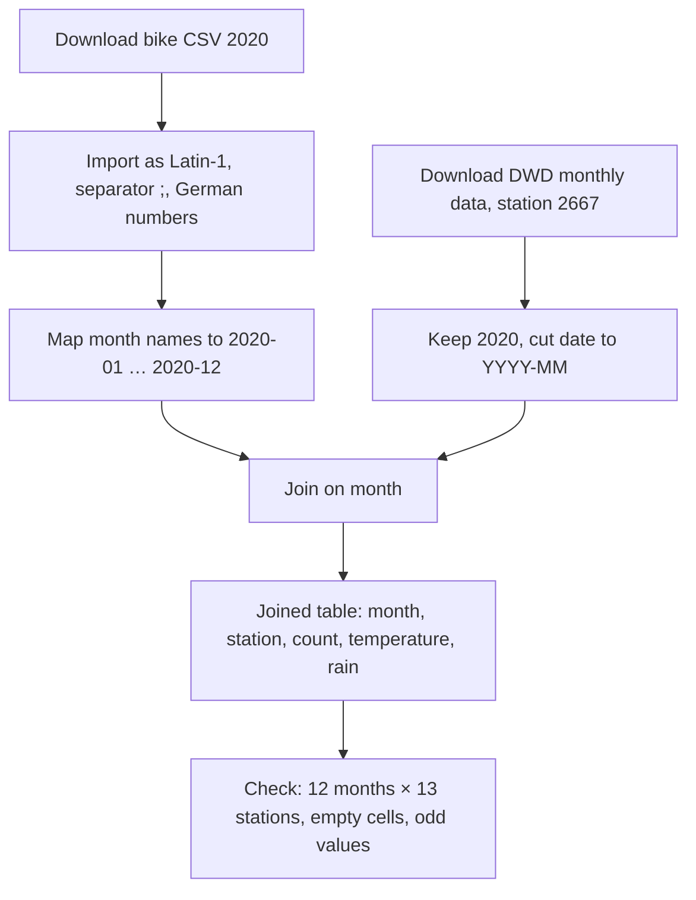

# Open data for my project: Bicycle traffic in Cologne

**Topic:** How many people cycle in Cologne, where, and in which months?
**Checked on:** 24 October 2026

## Contents

- [Task 5 · Find a dataset](#task-5--find-a-dataset)
- [Task 6 · Profile the dataset](#task-6--profile-the-dataset)
- [Task 7 · Review it with the FAIR principles](#task-7--review-it-with-the-fair-principles)
- [Task 8 · Plan what to combine it with](#task-8--plan-what-to-combine-it-with)
- [Sources](#sources)

---

## Task 5 · Find a dataset

### 1. Where I searched

| Kind of source | Source | Search terms | Result |
|----------------|--------|--------------|--------|
| City portal | [Offene Daten Köln](https://www.offenedaten-koeln.de/) | Fahrrad, Zählstellen | One dataset per year: *Fahrrad Verkehrsdaten Köln* |
| State portal | [Open.NRW](https://open.nrw/) | fahrrad verkehrsdaten köln | 33 hits: the Cologne datasets, plus counters from other cities such as Münster |
| National portal | [GovData](https://www.govdata.de/) | fahrrad köln | 30 hits; first hit: *Fahrrad Förderung Köln* (measures, not counts) |

### 2. Search like a machine

Request to the Open.NRW API:

```
https://open.nrw/api/3/action/package_search?q=fahrrad%20verkehrsdaten%20köln&rows=1
```

- **Hits (`count`):** 33
- **Title of the first hit:** Fahrrad Verkehrsdaten Köln 2019
- **Where the licence is given:** for the whole dataset (`license_id`) **and** for each file (`license` under `resources`), both `http://dcat-ap.de/def/licenses/dl-zero-de/2.0`.

I did not trust every field: the API marks the Cologne datasets as `"isopen": false`, although the licence, Datenlizenz Deutschland – Zero, is open (see [Licence](#5-licence)).

### 3. My dataset

**Fahrrad Verkehrsdaten Köln 2020** – one CSV file from the original publisher, the City of Cologne. I chose 2020 because it is a complete year and shows how cycling changed in the first year of the pandemic.

---

## Task 6 · Profile the dataset

### 1. Facts

| | Fahrrad Verkehrsdaten Köln 2020 |
|---|---|
| Publisher | Stadt Köln, on [Offene Daten Köln](https://www.offenedaten-koeln.de/), harvested by [Open.NRW](https://open.nrw/) |
| Original source | Automatic counters by Eco-Counter, shown on an [online map](https://data.eco-counter.com/ParcPublic/?id=677) |
| Link | [Fahrrad_Zaehlstellen_Koeln_2020.csv](https://www.offenedaten-koeln.de/sites/default/files/distribution/Fahrrad_Zaehlstellen_Koeln_2020.csv) |
| Formats | CSV, plus a link to the online map (HTML) |
| Size | 1 CSV file: 12 rows (months), 14 columns (1 month column + 13 counting stations) |
| Coverage | Cologne, January–December 2020, monthly totals per counting station |
| Last update and frequency | One dataset per year, published until 2022, none after that |
| Licence | Datenlizenz Deutschland – Zero – Version 2.0, stated for the dataset and for each file |

### 2. Stars

**★★★ – three stars:** openly licensed, structured, in an open format (CSV).
**Missing for the fourth star:** URIs that identify things – for example, each counting station with its own identifier, so others could link to the station *Deutzer Brücke* instead of to a column name.

### 3. Open the data

**Tools:** I opened the file in **Microsoft Excel** to look at it. The minimum, maximum and mean were calculated with a short Python script (with Claude's help, see `AI_USAGE.md`) that reads `;` as separator and removes the thousands dots.

| Column | Minimum | Maximum | Mean |
|--------|--------:|--------:|-----:|
| Deutzer Brücke | 69,823 (February) | 191,427 (September) | 137,146.5 |
| Universitätsstraße | 85,247 (December) | 174,569 (September) | 132,067.2 (9 months) |

**Empty cells:** *Universitätsstraße* has **3 empty cells** (January–March).

**Odd things:**

- **Separators:** `;` between columns, and `.` as thousands separator – `94.562` means 94,562 cyclists. Imported with the wrong language setting, it becomes 94.5.
- **Encoding:** When I opened the file in Excel by double-click, **all umlauts were broken** (e.g. in `Zülpicher Straße`, `Deutzer Brücke`, `März`). The file is not read as the encoding it was saved in – according to the lab, this series uses Latin-1. Fix: import it via *Data → From Text/CSV* and choose the right file origin (Western European / Latin-1 or UTF-8), separator `;` and German number format.
- **Header:** the first column is called `Jahr 2020`, but contains month names (*Januar*, *Februar* …). The year is only in the header and the file name.
- **Column name:** `Universitäts-straße` contains a hyphen, probably a line break from the original table.
- **Copied values?** *Vorgebirgswall* and *Universitätsstraße* have exactly the same value in August (122,325) and in November (87,552).
- **No totals row, no units**, no station IDs or coordinates.

### 4. Data dictionary

| Column | Meaning | Type and unit | Example |
|--------|---------|---------------|---------|
| `Jahr 2020` | Month of the year 2020 | Text, German month name | `Januar` |
| `Deutzer Brücke` | Bicycles counted on the Deutz Bridge in that month | Integer, bicycles per month | `94.562` |
| `Hohenzollernbrücke` | Bicycles counted on the Hohenzollern Bridge | Integer, bicycles per month | `58.212` |
| `Venloer Straße` | Bicycles counted on Venloer Straße, the busiest station | Integer, bicycles per month | `142.100` |
| `Universitäts-straße` | Bicycles counted on Universitätsstraße, empty before April | Integer, bicycles per month | `112.245` |

**Does the publisher document the columns?** No. There is only a one-sentence description of the dataset – no data dictionary, no units, no locations of the stations and no counting method.

### 5. Licence

- **Open?** Yes. Datenlizenz Deutschland – Zero 2.0 [conforms to the Open Definition](https://opendefinition.org/licenses/), even though Open.NRW marks the dataset as `"isopen": false`.
- **When I reuse it:** Zero means I may use, change and share the data without conditions – no attribution required. I will still credit the source, as good practice and so that my project is traceable.
- **Attribution line (TASL):**
  > "Fahrrad Verkehrsdaten Köln 2020" by Stadt Köln, [offenedaten-koeln.de](https://www.offenedaten-koeln.de/sites/default/files/distribution/Fahrrad_Zaehlstellen_Koeln_2020.csv), [Datenlizenz Deutschland – Zero – 2.0](https://www.govdata.de/dl-de/zero-2-0)

### 6. People

No personal data. The counters only record how many bicycles pass, and the file contains monthly totals per station – no names, photos, times or routes.

---

## Task 7 · Review it with the FAIR principles

| Principle | Rating | Evidence |
|-----------|:------:|----------|
| **F1** Unique, persistent identifier | ~ | A stable URL for each year on [Offene Daten Köln](https://www.offenedaten-koeln.de/), but no DOI |
| **F2** Rich metadata | ~ | Title, publisher, licence, format – but only one sentence of description, no method |
| **F3** Metadata include the identifier of the data | ✓ | The API lists the download URL of the CSV under `resources` |
| **F4** Registered in a searchable resource | ✓ | Found via Offene Daten Köln, Open.NRW and its API |
| **A1** Retrievable with a standard protocol | ✓ | HTTPS download and the CKAN API, no login |
| **A2** Metadata remain if the data is gone | ~ | Not stated; the yearly datasets since 2009 are all still online |
| **I1** Formal, shared language | ~ | CSV, but German number format, month names instead of ISO 8601 dates |
| **I2** FAIR vocabularies | ✗ | No vocabulary for stations, units or dates |
| **I3** References to other data | ✗ | No station IDs or coordinates to link to maps or other counters |
| **R1** Rich description of attributes | ✗ | No data dictionary, no units, no counting method |
| **R1.1** Clear licence | ✓ | The licence URI is in the metadata of the dataset and of each file (`license_id` in the [Open.NRW API](https://open.nrw/api/3/action/package_search?q=fahrrad%20verkehrsdaten%20k%C3%B6ln&rows=1)) |
| **R1.2** Provenance | ~ | Only a link to the Eco-Counter map; nothing on how the counts were checked or corrected |
| **R1.3** Community standards | ~ | Metadata follow DCAT-AP.de, the data itself does not follow a standard |

**Summary:** Easy to find and access, open licence – but weak on interoperability and reuse, mainly because there is no documentation. For milestone 2, I would add station IDs, coordinates, ISO dates and a data dictionary.

---

## Task 8 · Plan what to combine it with

### 1. Second source

**[DWD monthly climate data](https://opendata.dwd.de/climate_environment/CDC/observations_germany/climate/monthly/kl/)**, station 2667 Köln/Bonn – monthly temperature, rainfall and sunshine hours from the Deutscher Wetterdienst. Licence: [CC BY 4.0](https://creativecommons.org/licenses/by/4.0/).

### 2. Shared key

The key is the **month**. Both sources have it, but not in the same spelling:

| Source | The month as published | After cleaning |
|--------|------------------------|----------------|
| Fahrrad Verkehrsdaten Köln 2020 | `Januar`, year only in header and file name | `2020-01` |
| Fahrrad Verkehrsdaten Köln 2020 | `Dezember` | `2020-12` |
| DWD monthly climate data, station 2667 | `MESS_DATUM_BEGINN` = `20200101` | `2020-01` |
| DWD monthly climate data, station 2667 | `MESS_DATUM_BEGINN` = `20201201` | `2020-12` |

They do **not** match as published. Before joining, I must map the German month names to numbers, add the year from the file name, and cut the DWD date to year and month (ISO 8601: `YYYY-MM`).

### 3. Granularity

- **Time:** both are monthly – they align directly once the dates are cleaned.
- **Place:** the bike data has 13 stations in the city, the weather data one station at Köln/Bonn airport. I treat the weather as valid for the whole city and join it to every counting station.

### 4. Questions

1. How much do monthly bike counts drop in months with more rain or lower temperatures?
2. Do some stations (e.g. Rhine bridges vs. Stadtwald park) depend more on the weather than others?
3. Was the strong rise in spring 2020 caused by good weather – or does it remain when weather is taken into account (pandemic effect)?

### 5. Licences

Yes, I may combine both and publish the result. The bike counts are under **Datenlizenz Deutschland Zero** (no conditions), the weather data under **CC BY 4.0**, so I must **credit the Deutscher Wetterdienst** and say that I changed the data. I would publish the joined table under **CC BY 4.0** and credit both sources:

> "Fahrrad Verkehrsdaten Köln 2020" by Stadt Köln, offenedaten-koeln.de, dl-de/zero-2-0 ·
> "Monthly climate data, station 2667 Köln/Bonn" by Deutscher Wetterdienst, opendata.dwd.de, CC BY 4.0 – dates reformatted and joined by month

### 6. Next steps



### 7. Verdict

Yes, I would build my project on this dataset: it is open, easy to download and covers many years and stations. The biggest risk is quality – there is no documentation, some values look copied and some stations have gaps, so I cannot tell real changes from counting errors. A second risk is that the yearly files stop in 2022, so recent years would have to come from another source.

---

## Sources

- "Fahrrad Verkehrsdaten Köln 2020" by Stadt Köln, [offenedaten-koeln.de](https://www.offenedaten-koeln.de/sites/default/files/distribution/Fahrrad_Zaehlstellen_Koeln_2020.csv), [Datenlizenz Deutschland – Zero – 2.0](https://www.govdata.de/dl-de/zero-2-0)
- "Monthly climate data, station 2667 Köln/Bonn" by Deutscher Wetterdienst, [opendata.dwd.de](https://opendata.dwd.de/climate_environment/CDC/observations_germany/climate/monthly/kl/), [CC BY 4.0](https://creativecommons.org/licenses/by/4.0/)
- Metadata: [Open.NRW CKAN API](https://open.nrw/api/3/action/package_search?q=fahrrad%20verkehrsdaten%20k%C3%B6ln&rows=1)
